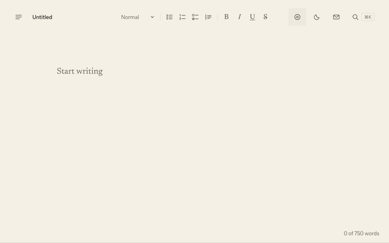

# Kansowriter

A calm, local-first place to write Markdown, and to send what you wrote as a letter that replays the way it was typed.

**[writer.kansoboard.com](https://writer.kansoboard.com)**



## How letters work

1. **Write.** Your draft and the timing of each keystroke stay on your device.
2. **Send as letter** (the envelope, ⌘⇧L, or the ⌘K palette). The whole letter is compressed into the link itself (`https://writer.kansoboard.com/l#v1.…`); nothing is uploaded or stored on a server. A letter too long for a link becomes a `.kansoletter` file.
3. **They watch it unfold.** The link opens a reader that replays the letter as it was written: the pauses, the words you changed. Anyone with the link can read it.

## Features

- **Writing**: a quiet page in Newsreader; the interface fades while you type; a thin line fills toward your daily word goal.
- **Focus**: dim other paragraphs or sentences, typewriter scrolling.
- **Formatting**: a toolbar and shortcuts that write plain Markdown (headings, lists, checklists, quotes, bold, italic, underline, strikethrough).
- **Letters**: replayable letters by link or file, with a live preview and a choice of where the replay starts.
- **Offline**: an installable PWA; drafts live in IndexedDB, with Markdown, text and full-backup export and import.
- **Mac app**: the same app as a native macOS build (Tauri 2).
- **Everything in ⌘K**: every setting and command lives in the palette; there is no settings screen.

## Privacy

There is no account and no backend. Drafts never leave your device unless you export them or send a letter, and a letter lives only in its link or file: anyone you share it with (or who sees it in a chat or browser history) can read it.

## Development

Node 22. `npm ci`, then:

| Script | What it does |
|---|---|
| `npm run dev` | Vite dev server |
| `npm run build` | design tokens, typecheck, production build to `dist/web` |
| `npm run preview` | serve the build on port 4317 |
| `npm test` | unit tests (Vitest) |
| `npm run e2e` | Playwright end-to-end tests (Chromium, WebKit, phone emulation) |
| `npm run typecheck` / `lint` / `format:check` | static checks |
| `npm run tokens:check` | `DESIGN.md` tokens match `src/ui/tokens.css` |
| `npm run csp:check` | the CSP hashes cover the inline theme script |
| `npm run desktop:dev` / `desktop:build` | the macOS app (needs Rust and the Tauri CLI) |
| `npm run record:demo` | re-record the homepage demo (below) |

### The demo video

The homepage video, its posters and screenshots, and the GIF above are recorded from the real built app by `scripts/record-demo.ts`: Playwright types a short letter at a human pace, sends it, opens the link in the reader, and captures CDP screencast frames at 2x scale for each theme. ffmpeg assembles them at a steady 30 fps and encodes MP4 (H.264), WebM (VP9), the WebP posters and the GIF.

```sh
brew install ffmpeg webp   # ffmpeg and cwebp
npm run build && npm run record:demo
```

Output goes to `src/ui/demo/` and `docs/demo.gif`. Options: `--theme paper|night`, `--base-url <running preview>`, `--keep` (keep the raw frames in `.demo-frames/`).

The build stamps its git commit (shown in the homepage footer and the palette's About row): `VERCEL_GIT_COMMIT_SHA`, else `git rev-parse HEAD`, else `dev`.
